# Architecture

Bus stop aibou is a static, client-only web app. It has no build step, no backend and no secrets. The browser loads plain ES modules, reads two bundled JSON files, and calls three public APIs directly (all three allow cross-origin requests). Everything the app remembers lives in `localStorage`.

This document covers how the pieces fit together. For the product reasoning behind them, see [PRD.md](PRD.md).

## 1. System context

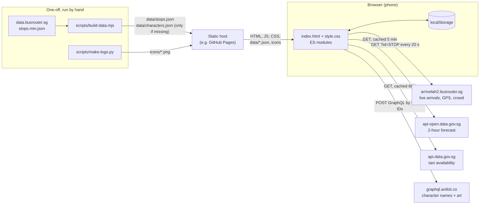

| Dependency | Used for | Called from | Failure behaviour |
|---|---|---|---|
| arrivelah2 | Bus arrivals, GPS, crowd load | `refresh()` in `app.js` | Keep the last list with a "Could not refresh" line, or show a retry message |
| data.gov.sg 2-hour forecast | Weather theme and dialogue | `getWeather()` | Reuse the last good forecast for up to 30 min, then show no weather |
| data.gov.sg taxi availability | Taxi spirits in the Scene | `getTaxis()` | No taxis drawn |
| AniList GraphQL | Character names and artwork | `ensureCharacters()` | Fall back to names from `data/characters.json` and an initial letter in place of artwork |
| `data/stops.json`, `data/characters.json` | Stop list and character pool | `loadData()` | "Could not load the bus stop list" (the app cannot work without them) |

## 2. Code layout and module dependencies

Decision logic lives in pure modules (`lib.js`, `board.js`, `fixes/*`). `app.js`, `scene.js` and `talk.js` are the only modules that touch the DOM or canvas; the tests run them in happy-dom (section 11).

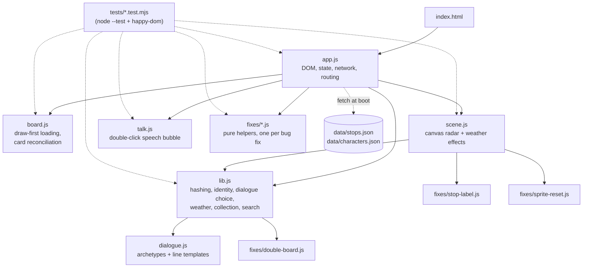

| File | Role |
|---|---|
| `index.html` | Page skeleton: header, landing, picker, carousel (`#peek`), tabs, three tab panels, live-region announcer, footer. `body[data-view]` is `home` or `stop` |
| `style.css` | Mobile-first styles. Weather themes are CSS variables switched by `body[data-weather]` |
| `app.js` | The only stateful module: boot, routing, polling, network calls, rendering of board, collection, carousel and picker |
| `lib.js` | Pure core logic (see section 5) |
| `board.js` | `loadBoard` (arrivals draw first, decoration later), `reconcileKeys`, `avatarNeedsReplacing` |
| `scene.js` | `createScene(canvas)` returns `{ setData, start, stop }`; owns its own `requestAnimationFrame` loop |
| `talk.js` | `playTalk()`: double-click (or Enter/Space on) a card's picture and it floats out with a speech bubble showing the line in English and Japanese. Blocks the page (`inert`) while it plays |
| `dialogue.js` | `ARCHETYPES`, and `DIALOGUE` / `DIALOGUE_JA` string templates keyed by archetype then situation, index-aligned |
| `fixes/*.js` | Small pure helpers extracted while fixing review findings, each with a `tests/p3-*.test.mjs` |
| `scripts/build-data.mjs` | Regenerates the stop list; creates a starter character pool only if none exists |
| `scripts/make-logo.py` | Rebuilds the logo SVG from `scripts/aibou-dots.txt` and renders the PNG icons |
| `manifest.webmanifest`, `icon.svg`, `icons/` | Installability and icons |

`fixes/favicon.js` is used only by its test (it checks the icon PNG sizes). `fixes/taxi-toggle.js` exports `needsTaxiFetch`, but `app.js` uses its own inline cache check in `getTaxis()`.

## 3. Boot, routing and views

There is no router library. The URL holds at most one parameter, `?stop=CODE`. `route()` runs once at boot and again on every `popstate`.

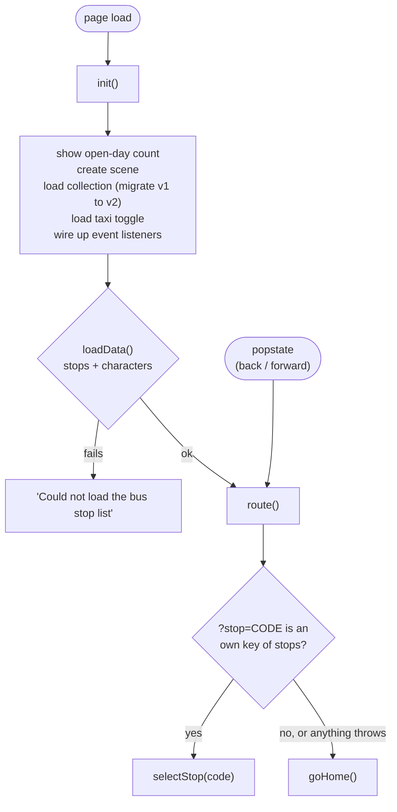

The app has two top-level views. The stop picker can open on top of either.

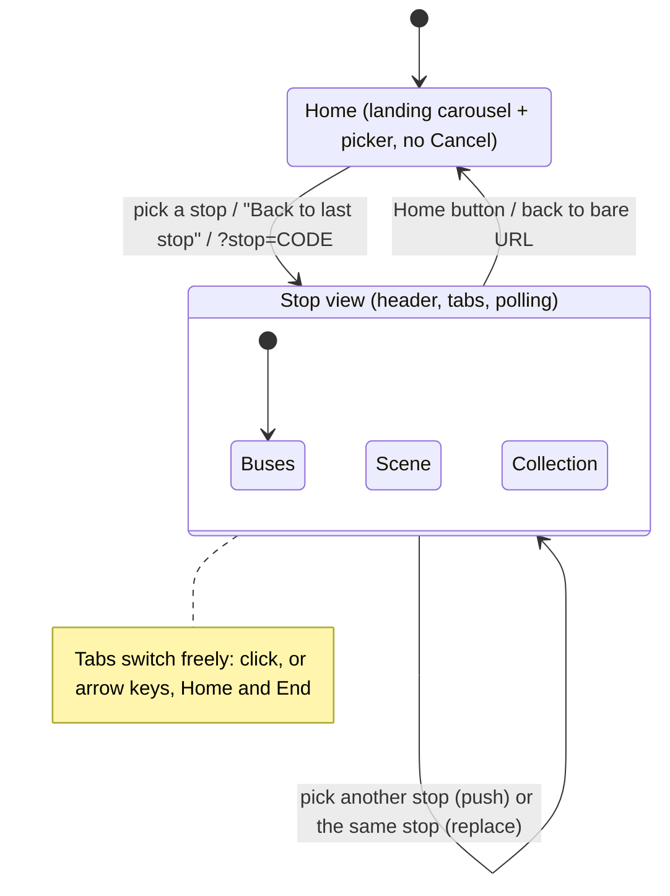

What each transition does:

- **`selectStop(code)`**: records the stop as `last-stop`, logs today in `open-days`, pushes or replaces the history entry (`historyAction`), shows the tabs, draws "Looking for buses…", calls `refresh()` and starts the 20-second poll.
- **`goHome()`**: stops polling, cancels the refresh gate so an in-flight request cannot draw on the home page, stops the scene, clears the weather theme, shows the landing page and picker, and offers "Back to <last stop>". The carousel is built once, on the first visit.
- **Tabs**: `showTab()` follows the ARIA tab pattern (arrow keys, Home, End via `fixes/a11y.js`). The Scene's animation loop runs only while the Scene tab is visible and the page is not hidden.
- **Picker**: `fixes/picker-close.js` decides when it can close. On Home it is the main UI and only a choice closes it; on a stop, Cancel, Escape or a tab change also close it.

## 4. The refresh cycle

`refresh()` is the heart of the stop view. It runs on stop selection, every 20 seconds while the page is visible, on the refresh button, and when the page becomes visible again.

Two rules shape it:

1. **Latest stop wins.** `createRefreshGate()` hands out a ticket per refresh. Starting a refresh for another stop (or going Home) makes the older ticket stale, and every draw checks `isCurrent()` first. A second refresh for the stop that is already loading is skipped.
2. **Arrivals draw first.** `loadBoard()` draws as soon as arrivals return, using cached artwork and the last known weather. Weather and fresh artwork are decoration: each triggers a redraw when it arrives, and their failures are swallowed.

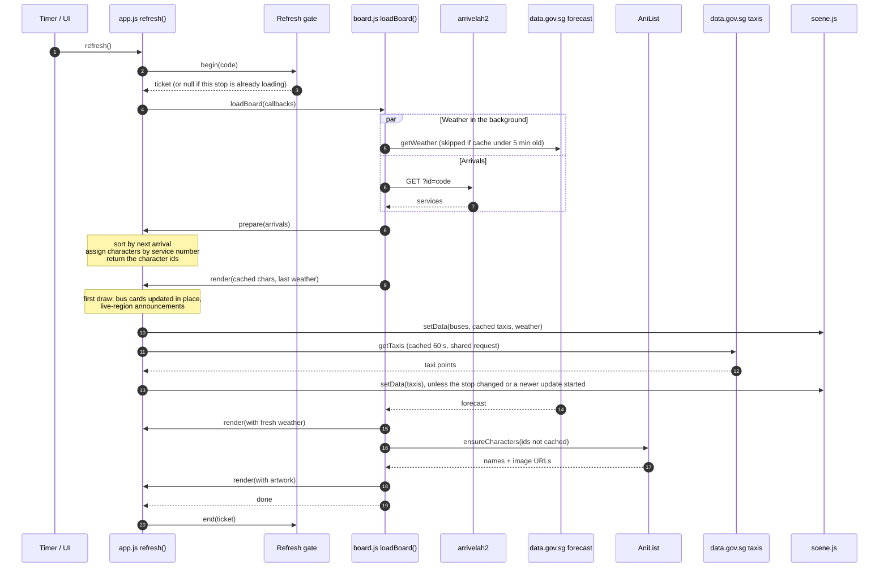

Every `render` call checks `gate.isCurrent(ticket)`, so a slow response for a stop the user has left is dropped. The ticket is held until decoration has finished, so the late weather and artwork draws are not mistaken for stale ones. The scene does not use the ticket for taxis: the taxi list often arrives after the ticket is released, so `updateScene()` draws the buses at once and uses its own sequence number for the late taxi update.

When the arrivals request fails, `fixes/keep-last-list.js` picks one of two outcomes:

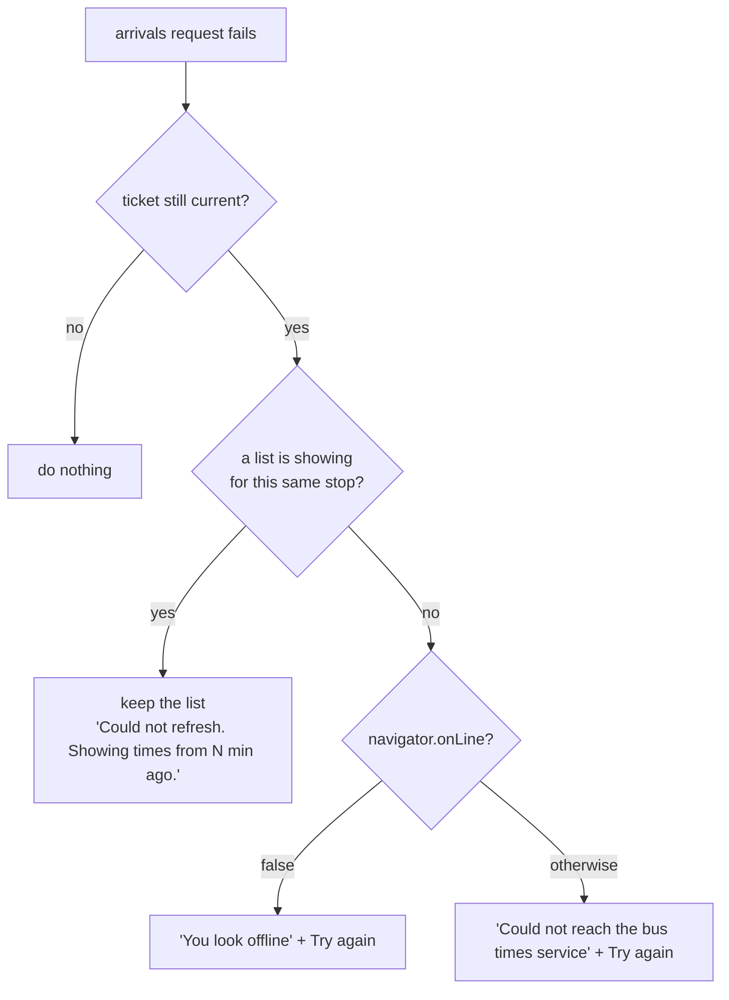

An empty arrivals response (night, or nothing due yet) is not an error: `prepare()` shows a "No buses right now" message, clears the scene, and returns `null` so nothing else is drawn.

### Board rendering

`renderServices()` is idempotent. Cards are keyed by service number, and `reconcileKeys()` decides which to keep, add, remove and reorder. Existing cards are updated in place, so keyboard focus, loaded images and the entry animation survive each poll. `avatarNeedsReplacing()` replaces a picture only when the character or image URL changed, and a URL that failed to load is remembered so polls don't retry it.

## 5. Character identity and dialogue

A bus service number always maps to the same character, at every stop, on every day. There is no server and no randomness: everything is derived from a 32-bit FNV-1a hash of the service number.

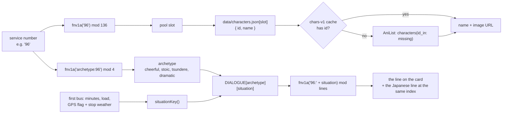

Consequences of this design:

- `data/characters.json` is **frozen**. Adding, removing or reordering entries changes which character every bus gets. `build-data.mjs` never overwrites it.
- Two buses at one stop can share a character. An earlier version moved a colliding bus to the next free slot, but that made a bus's character depend on the other buses at the stop, so it was dropped (PRD section 10).
- A card's line changes only when its situation changes, not on every poll.

`situationKey()` checks the situations in a fixed priority order, so a packed bus in the rain reads as "packed":

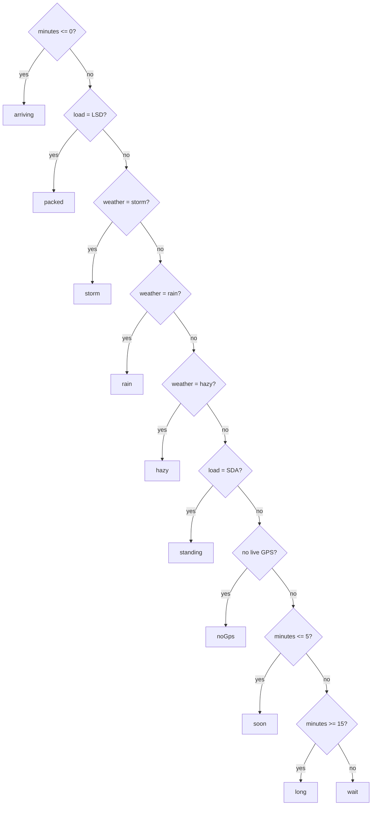

## 6. Weather

The forecast is one national response that covers every area, so it is fetched at most every 5 minutes and shared by all stops. Each stop picks its nearest forecast area.

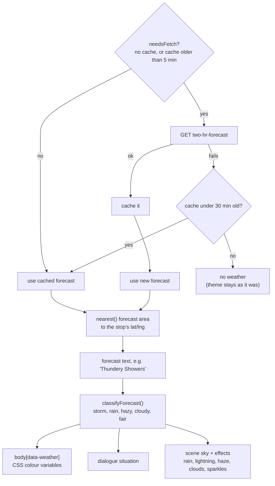

`themeKind()` keeps the current theme when weather is missing, so a failed refresh never flashes the page back to "fair". Once no forecast younger than 30 minutes is left, the theme returns to fair and the board stops reusing the stop's last weather (`state.weather` records when its forecast was fetched).

## 7. Collection

A character joins the collection only when the rider confirms they boarded that bus. Seeing a bus is not enough.

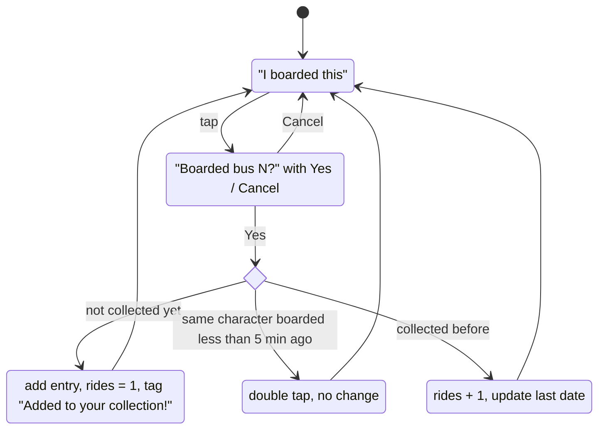

`recordBoarded()` in `lib.js` returns a new collection object rather than mutating the old one, and `setCollection()` saves it to `collection-v2`. The Collection tab filters stored entries through `collectionForPool()` (so ids no longer in the pool are ignored, with numeric pool ids compared against string storage keys) and lists collected characters first with `orderPool()`.

## 8. Scene (Stage 3)

`scene.js` draws a radar-style map centred on the stop. `app.js` converts GPS positions to metre offsets from the stop (`metersFrom`) and hands the scene plain data. The scene never fetches anything except character images.

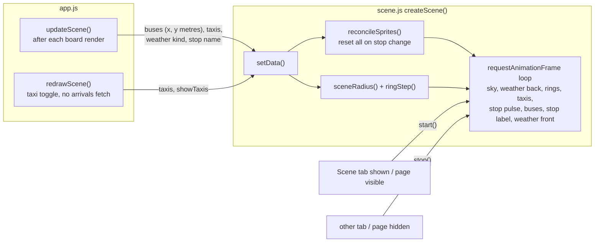

- Bus sprites glide towards their new positions between polls. A stop change drops every sprite, so buses appear in place instead of sweeping across the map.
- The next bus of each service is drawn larger and on top. Its ring colour shows crowd load (green seats, amber standing, red limited standing).
- With reduced motion, positions and radius snap, and rain, sparkles, lightning and taxi wobble are off.
- When the loop is stopped, `setData()` and resizes still draw one static frame.

## 9. State and persistence

All runtime state sits in one `state` object in `app.js`. Everything that must outlive a page load goes through a small `store` wrapper around `localStorage` that swallows errors (private mode, blocked storage), so storage problems never break the page.

| Key | Shape | Written by | Purpose |
|---|---|---|---|
| `chars-v1` | `{ [anilistId]: { name, img } }` | `ensureCharacters()` | Character detail cache, keeps AniList traffic well under 30 requests a minute. New entries are merged into the stored copy at save time, so overlapping fetches do not overwrite each other |
| `collection-v2` | `{ [anilistId]: { svc, first, last, rides, lastAt } }` | `setCollection()` | Boarded characters |
| `collection-v1` | legacy | (read once) | Migrated at boot; only entries marked as ridden carry over |
| `last-stop` | stop code | `selectStop()` | "Back to <stop>" on the home page |
| `open-days` | sorted `YYYY-MM-DD[]` (Singapore time) | `selectStop()` | The PRD success metric: days the app was used at a stop |
| `taxi-spirits` | boolean | taxi toggle | Show or hide taxis in the Scene |

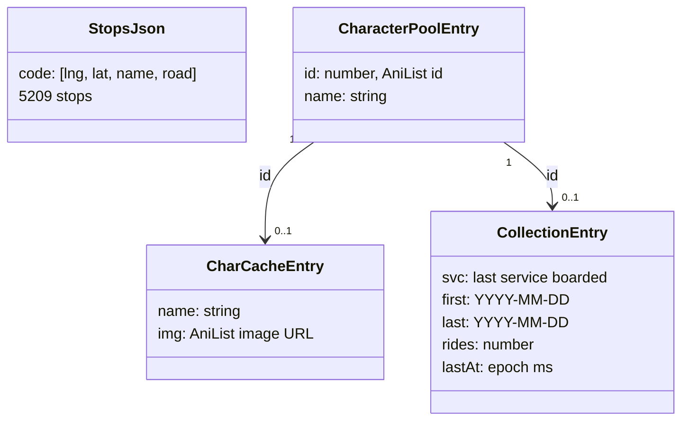

## 10. Timing and limits

| Constant | Value | Where | Why |
|---|---|---|---|
| Arrivals poll | 20 s, skipped while hidden | `REFRESH_MS` | arrivelah2 caches about 15 s; never poll faster |
| Forecast cache | 5 min fresh, 30 min max stale | `FORECAST_TTL_MS`, `FORECAST_MAX_STALE_MS` | One national forecast; survive brief outages |
| Taxi cache | 60 s, one shared in-flight request | `TAXI_TTL_MS` | Large payload, slow-changing |
| Taxis drawn | nearest 80 within 3 km | `MAX_TAXIS`, `TAXI_RADIUS_M` | Keep the canvas readable |
| Fetch timeout | 10 s (taxis 15 s) | `fetchJson()` | Fail into the error states instead of hanging |
| Repeat boarding window | 5 min | `fixes/double-board.js` | Treat a double tap as one ride |
| "Not in Singapore" | nearest stop over 5 km away | `fixes/geo-far.js` | Reject far-off locations |
| Carousel | advances every 3.5 s, pauses 8 s after interaction | `startCarousel()` | Off entirely under reduced motion |

## 11. Testing

`npm test` runs `node --test tests/*.test.mjs`. `npm run coverage` adds Node's built-in coverage and fails below 70% lines, branches or functions; coverage is currently above 99% lines, 94% branches and 98% functions, with every source file loaded. The only dependency is happy-dom (dev-only).

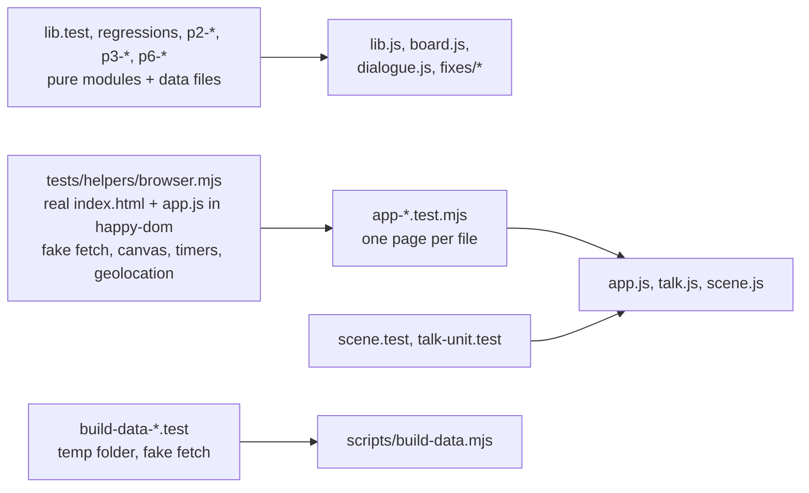

Each `app-*.test.mjs` file boots one page and runs its tests in order, because Node counts coverage for only one copy of `app.js` per process.

| Test file | Covers |
|---|---|
| `lib.test.mjs`, `regressions.test.mjs`, `p2-*`, `p3-*`, `p6-*` | Pure logic, the review fixes, and the data files and icons |
| `app-stop.test.mjs` | Stop view: arrivals, polling, failures, boarding, tabs, scene, collection, picker, navigation, carousel |
| `app-home`, `app-degraded`, `app-boot-fail` | Home page and storage migration, failing decoration services and storage, a failed stop list |
| `app-scene-slow-taxis`, `app-weather-expiry`, `app-character-cache` | Regression tests for the three API fixes |
| `app-talk`, `app-talk-motion`, `talk-unit` | The double-click speech bubble |
| `scene.test.mjs` | Canvas drawing for every weather kind and reduced motion |
| `build-data-new`, `build-data-frozen` | The data script, including never overwriting the character pool |

## 12. Deployment

Publish the repository folder as-is to any static host. ES modules need the page served over HTTP(S), not `file://`, and "Use my location" needs HTTPS. Locally, `npm run serve` starts `python3 -m http.server 8765`.

## 13. Known limitations

- On the home page, the picker's Cancel button stays visible and does nothing (a fix is on the `claude/affectionate-sagan-yujlxg` branch).
- Home keeps the last stop's weather theme.
- Character ids that AniList does not return are requested again on every poll.
- Character artwork is hot-linked from AniList rather than copied into the repo, by design.
- arrivelah2 is a community proxy. All arrivals calls go through `refresh()` in `app.js`, so swapping it for LTA DataMall means changing `ARRIVALS_API` and `normaliseBuses()`.
